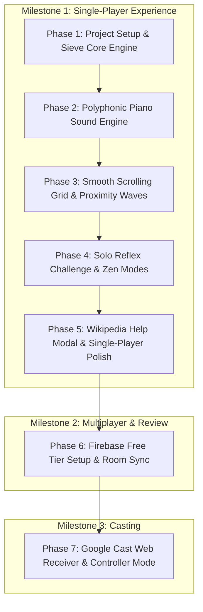

# Sieve of Eratosthenes (v3.0.3+0)
## Architectural Design & Implementation Plan

---

## 1. Project Concept & Core Mechanics

The Sieve of Eratosthenes is an ancient, elegant algorithm for finding all prime numbers up to a given limit by iteratively marking the multiples of each prime as composite. This project turns the algorithm into a living, rhythmic, audio-visual experience and competitive reflex/number-sense game.

### 1.1 The Sieve Rhythm Engine
* **Beat Clock:** The engine counts forward at an adjustable rate (default: $1.0\text{ Hz} = 60\text{ BPM}$).
* **State & Factorization:** 
  * Maintains an ordered set of discovered primes $\mathcal{P} = \{p_1, p_2, \dots\}$.
  * For each current integer $N \ge 2$:
    * Test $N$ against all known primes $p \in \mathcal{P}$ where $p \le \sqrt{N}$ (or trial division).
    * If $N$ has prime factors, decompose $N$ into its prime factorization:
      $$N = p_1^{a_1} \cdot p_2^{a_2} \cdots p_k^{a_k}$$
    * If $N$ is divisible by no known prime, $N$ is prime! $N$ is added to $\mathcal{P}$ and triggers a new prime arrival event.
* **Audio-Visual Emission on Beat:**
  * For composite $N$: Trigger audio tones for all prime factors $p_i$, sounding simultaneously as a harmonic chord.
  * For prime $N$: Introduce a distinct, prominent new sound and visual celebratory flare.
  * For prime powers ($a_i > 1$): Play the base prime note along with upper octaves ($2\times, 4\times$) or higher velocity/gain per factor multiplicity.

---

## 2. Audio Design & Harmonic Piano Chords

### 2.1 Acoustic Grand Piano Samples
Rather than purely synthetic beeps, the app uses real acoustic piano samples to create rich, organic chords.

#### Open Source Piano Sample Libraries:
* **Tone.js Instruments / Soundfont Piano (MIT / CC0 License):**
  * Lightweight, beautifully recorded acoustic grand piano samples.
  * Stored in compressed `.mp3` or `.ogg` format with key note anchors across 4–5 octaves (e.g., $C_2$ to $C_6$).
  * Total asset size is under $1.5\text{ MB}$, making it instantaneous to download on mobile web.
* **Salamander Grand Piano (CC-BY 3.0):**
  * Captured from a Yamaha C5 grand piano. Pristine acoustic tone with natural hammer strike and room resonance.
* **Playback & Scaling Architecture:**
  * Anchor samples (e.g., $C_2, E_2, G_2, C_3, \dots$) are pre-decoded into memory buffers.
  * Intermediate pitches or higher primes are dynamically pitch-shifted using Web Audio buffer playback rate (`playbackRate.value = targetFreq / baseFreq`) or native audio resamplers, eliminating latency and memory bloat.

### 2.2 The Harmonic Prime Spectrum
In music theory and physics, the natural overtone series is built from integer multiples of a fundamental frequency. We map primes to musical intervals so that composite numbers produce natural, pleasant piano chords:

* **Prime 2 (The Octave / Root Fundamental):** 
  * Pitch: $C_3$ ($130.81\text{ Hz}$).
  * Role: The rhythmic bass heartbeat and lowest acoustic anchor.
* **Prime 3 (The Perfect Fifth):**
  * Pitch: $G_3$ ($196.00\text{ Hz}$, $3/2$ ratio).
  * Together with 2 ($N=6$): Forms an open, resonant **Power Chord** ($C - G$).
* **Prime 5 (The Major Third):**
  * Pitch: $E_4$ ($329.63\text{ Hz}$, $5/4$ ratio).
  * Together with 2 & 3 ($N=30 = 2 \cdot 3 \cdot 5$): Resolves into a bright, consonant **C Major Triad** ($C - E - G$).
  * $N=10 = 2 \cdot 5$: Major Tenth ($C - E$).
  * $N=15 = 3 \cdot 5$: Minor Third interval ($E - G$).
* **Prime 7 (The Harmonic / Dominant 7th):**
  * Pitch: $B^\flat_4$ ($466.16\text{ Hz}$, $7/4$ ratio).
  * Together with 2, 3, 5 ($N=210$): Creates a rich **Dominant 7th chord** ($C - E - G - B^\flat$).
* **Prime 11 (The Augmented 11th / Lydian Fourth):**
  * Pitch: $F^\sharp_5$ ($739.99\text{ Hz}$, $11/8$ ratio).
* **Prime 13 (The Natural 13th / Major Sixth):**
  * Pitch: $A_5$ ($880.00\text{ Hz}$, $13/8$ ratio).
* **Higher Primes ($p \ge 17$):**
  * Mapped algorithmically into natural scale positions across the higher piano octaves ($C_5 - C_7$) so the instrument continues sounding musical and coherent as high primes appear.

### 2.3 Factor Multiplicity (Higher Powers)
When a prime factor appears multiple times ($N = p^k, k \ge 2$):
* **Octave Stacking:** For each additional exponent power, add the corresponding octave harmonic ($f \cdot 2^{k-1}$). For instance:
  * $4 = 2^2 \implies C_3 + C_4$
  * $8 = 2^3 \implies C_3 + C_4 + C_5$
  * $12 = 2^2 \cdot 3 \implies C_3 + C_4 + G_3$
* **Velocity & Accent:** Apply $+2.0\text{ dB}$ volume boost and slightly stronger acoustic strike per multiplicity.

---

## 3. Visual Interface & Continuous Proximity Waves

### 3.1 The Scrolling Number Matrix
* **Layout:** Vertical or horizontal flowing grid showing numbers preceding, current, and upcoming.
* **Scroll Animation:** Continuous smooth scrolling interpolation based on fractional time $t$, not jarring jumps.
* **Visual States:**
  * **Upcoming:** Muted slate gray / subtle borders.
  * **Current ($N$):** Center spotlight, pulsing scale animation $(1.0 \to 1.15 \to 1.0)$, flashing color corresponding to factors.
  * **Composite Played:** Rings radiate outwards colored by the contributing prime factor colors.
  * **Prime Discovered:** Golden / electric amber flare with particle burst.
  * **Historical (Passed):** Retains color-coded badge indicating prime status or factor breakdown.

### 3.2 Mathematical Verification of the Proximity Function
The plan proposed a progress bar metric:
$$f(t) = \left| 2 \cdot \frac{((\text{speed} \cdot t) \pmod p)}{p} - 1.0 \right|$$

#### Continuity Proof & Analysis:
1. Let $x(t) = (\text{speed} \cdot t) \pmod p$, where $x(t) \in [0, p)$.
2. Inside the open interval $(k p, (k+1) p)$, $x(t)$ is linear and continuous.
3. At the boundary where $t \to \left(\frac{k p}{\text{speed}}\right)^-$:
   * $x(t) \to p^-$
   * $\frac{2 x(t)}{p} - 1.0 \to \frac{2 p}{p} - 1.0 = +1.0$
   * $\left| +1.0 \right| = 1.0$
4. At the boundary where $t = \frac{k p}{\text{speed}}$ (from the right, $t \to^+$):
   * $x(t) = 0$
   * $\frac{2(0)}{p} - 1.0 = -1.0$
   * $\left| -1.0 \right| = 1.0$
5. **Conclusion:** Because $\lim_{t \to t_0^-} f(t) = \lim_{t \to t_0^+} f(t) = f(t_0) = 1.0$, **the function is mathematically continuous for all $t \in \mathbb{R}$!**
6. **Waveform Shape:** It is an exact inverted triangle wave bounded between $[0.0, 1.0]$:
   * Value is **$1.0$** (Maximum bar height/width) exactly when $\text{speed} \cdot t$ is a multiple of $p$ ($N \equiv 0 \pmod p$).
   * Value drops smoothly to **$0.0$** at the midpoint between multiples ($N \equiv p/2 \pmod p$).
   * It rises smoothly back to **$1.0$** as $N$ approaches the next multiple.

### 3.3 Dynamic Bottom Progress Bars
* **Layout:** A unified multi-tier dashboard pinned to the bottom.
* **Proximity Gauge:** Each discovered prime gets a color-coded bar whose fill corresponds to $f(t)$.
* **Adaptive Scaling & Density Management:**
  * As the prime list grows to 20, 50, 100+ primes, showing all bars simultaneously would cause unreadable visual noise.
  * **Visibility Filter:** 
    * Display the primary small primes ($2, 3, 5, 7, 11, 13$) as persistent tracks.
    * For larger primes, only render bars for primes that are currently within the active window:
      $$f(t) \ge 0.70 \quad \text{(i.e., imminent multiples within 15\% of arrival)}$$
    * Display prime number badge inside the bar when width $> 28\text{px}$.

---

## 4. Single-Player Game Experience (Immediate Focus)

### 4.1 Zen / Exploration Mode
* **Tempo Slider:** Smoothly adjust speed from $0.2\text{ Hz}$ ($1\text{ beat per 5 seconds}$) up to $10.0\text{ Hz}$.
* **Factor Inspector:** Tap on any number on the board (past, present, or future) to inspect its prime factorization and hear its piano chord isolated.
* **Mute/Solo Prime Tracks:** Toggle individual primes to isolate their rhythm and hear how the sieve weaves together.

### 4.2 Solo Reflex Challenge
* **The "PRIME!" Buzzer Button:** A prominent button at the bottom of the screen.
* **Timing Window:** The player must press the button when the next approaching number is prime (within a configurable reaction window before/at the beat).
* **Scoring Rules:**
  * Tap on Prime: **$+100 \text{ points} \times \text{speed multiplier}$**.
  * Tap on Composite: **$-75 \text{ points}$ penalty** (visual screen shake and low thud sound).
  * Missed Prime: Streak resets to 0.
* **Streak Multiplier:** Consecutive correct prime identifications build a combo multiplier ($1.5\times, 2.0\times, 3.0\times$).
* **Local High Scores:** Stored locally in browser `localStorage` or device preferences.

---

## 5. Future Multiplayer Architecture & Cost Analysis

*(To be implemented after the single-player experience is complete and reviewed)*

### 5.1 Technology Selection
* **Wi-Fi Direct / P2P Wi-Fi:** Android-only, requires invasive location/nearby permissions, breaks internet connectivity, and is completely unsupported on Web and iOS Safari.
* **Bluetooth (BLE):** Does not support peripheral/hosting mode on Web browsers; requires native OS permissions.
* **Recommended: Firebase Realtime Database (Room Codes):**
  * Instant room code join (e.g., room code `7351` or QR code).
  * Works on every platform (Android, iOS Safari, Chrome, Edge, desktop).
  * Sub-50ms synchronization with NTP server timestamp clock sync.

### 5.2 Cost Analysis (Zero-Cost Target)
* **Firebase Spark Plan (Free Tier):**
  * **Cost: $0.00 / month forever (No credit card required).**
  * **Realtime Database Limits:**
    * 1 GB stored data (a room state is only ~2 KB).
    * 10 GB/month network download.
    * 100 simultaneous active client connections.
  * **Firebase Hosting Limits:**
    * 10 GB storage, 360 MB/day data transfer, free SSL on custom domain.
  * **Conclusion:** The free Spark tier easily supports thousands of active game sessions per month at zero cost.

---

## 6. Future Casting Architecture (TV / Chromecast)

*(To be implemented after multiplayer review)*

### 6.1 How Google Cast Works
Google Cast separates the system into two applications:
1. **The Sender Application:** Runs on the user's mobile device or desktop Chrome browser.
2. **The Web Receiver Application:** A web application (HTML5/Canvas/WebAudio) hosted on Firebase Hosting that executes inside the Chromecast / Google TV's embedded Chromium browser.

* **Dual Experience:**
  * TV displays the full-screen 4K scrolling number grid, particle explosions, proximity bars, and plays the rich piano chords through the TV sound system.
  * Mobile phone acts as a low-latency handheld controller and buzzer.

---

## 7. Educational Content & Help

* **In-App Tutorial & Help Modal:**
  * Interactive explanation of the Sieve of Eratosthenes algorithm.
  * Visual guide explaining how prime numbers are the "atoms" of integers, and how composite numbers are chords of those atomic frequencies.
  * Direct clickable link to the [Wikipedia article on Sieve of Eratosthenes](https://en.wikipedia.org/wiki/Sieve_of_Eratosthenes).

---

## 8. Staged Implementation Plan

### Milestone 1 Tasks (Single-Player Experience):
* [x] **Phase 1: Project Scaffolding & Core Engine (COMPLETED):**
  * Initialized Flutter project configured for Web and Android.
  * Implemented deterministic mathematical sieve state generator and prime cache in `lib/models/sieve_engine.dart`.
  * Implemented sub-millisecond precision zero-drift stopwatch beat timer in `lib/models/beat_clock.dart`.
  * Set up development tooling: `setup.sh`, `Makefile` (`make ASSETS`, `make stage`), `icon.xcf`, and launcher icons.
  * Created unit test suites in `test/sieve_engine_test.dart` and `test/beat_clock_test.dart` (14 passing tests).
* [x] **Phase 2: Piano Audio Engine (COMPLETED):**
  * Integrated zero-latency polyphonic Web Audio API synthesis in `lib/models/audio_engine_web.dart` with stub fallback in `lib/models/audio_engine_stub.dart`.
  * Polyphonic audio engine sounding simultaneous prime factor chords for composites and octave overtones for prime powers.
  * Sparkling chime for prime numbers and percussive countdown clicks for 0 and 1.
  * Browser Autoplay Policy unlock handling on any user click or button press.
  * Audio mute toggle control in AppBar.
* [x] **Phase 3: Visual Interface (COMPLETED):**
  * Built smooth-scrolling number stream (`lib/widgets/number_grid.dart`) with prime glow and composite factor badges.
  * Implemented bottom proximity dashboard (`lib/widgets/proximity_dashboard.dart`) using the continuous triangle wave formula $f(t) = |2 \cdot ((speed \cdot t) \pmod p)/p - 1.0|$.
  * Implemented interactive Factor Inspector modal sheet (`lib/widgets/factor_inspector.dart`).
* [x] **Phase 4: Solo Gameplay - Reflex Challenge & Scoring (COMPLETED):**
  * Implemented silent "Guess" button positioned to the right of "Step Forward".
  * Live score display, streak multipliers ($2\times, 3\times, \dots$), and color-coded feedback ($+100$, $-50$).
  * Built dedicated Game Rules & How-to-Play help dialog (`lib/widgets/game_help_dialog.dart`).
* [x] **Phase 5: Educational Help (COMPLETED):**
  * Built the help dialog (`lib/widgets/about_dialog.dart`) with algorithm breakdown and Wikipedia link.
  * Created `doc/about.md` and compiled to `assets/about.html`.
